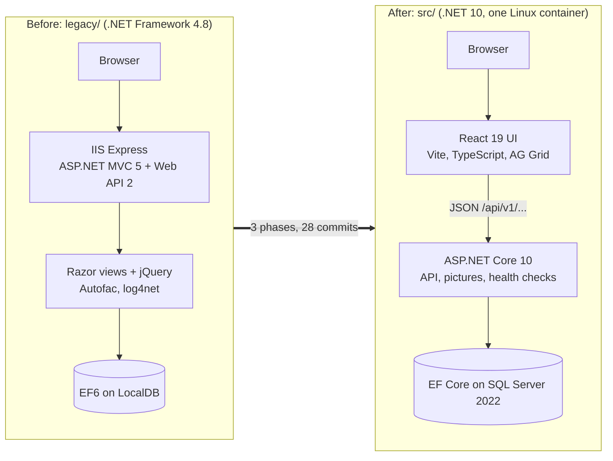
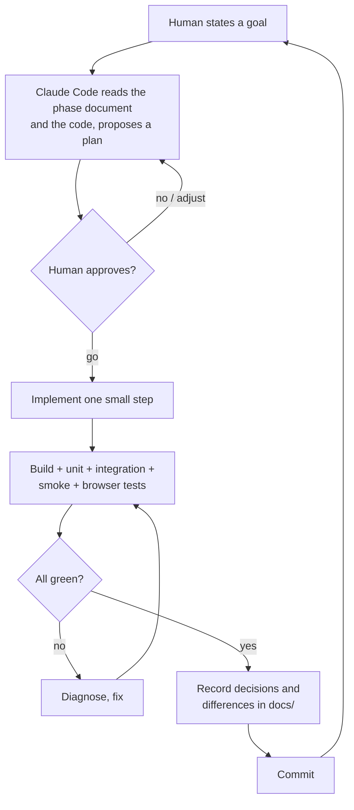
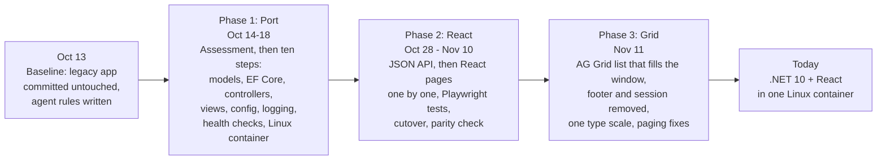

# eShopMvc

**A classic ASP.NET MVC 5 application, modernized in four weeks by an AI agent that was never allowed to guess.**

    

Most legacy-modernization stories end with "we rewrote it and it mostly works." This repository is the opposite
experiment: a small, real application, moved from .NET Framework to .NET 10 and from server-rendered Razor to a
React UI, **entirely by [Claude Code](https://claude.com/claude-code)**, with a human setting the direction, approving
every plan and making every judgement call, and with every deliberate behaviour change written down and tested.

The interesting part is not the app. It is the **method**, and the paper trail it left behind.

---

## Where the code came from

The starting point is **eShopLegacyMVC**, the sample application from Microsoft's free e-book
*Modernize existing .NET applications with Azure cloud and Windows Containers* (the
[eShopModernizing](https://github.com/noctua-innovations-inc/eShopMvc) samples). It is a catalog manager for a
fictional shop: list products, view one, create, edit, delete. It is a deliberately typical "lift me to the cloud"
candidate:

| | The legacy app (`legacy/`) |
|---|---|
| Runtime | .NET Framework 4.8 on IIS Express |
| Web | ASP.NET MVC 5.2.7 **plus** Web API 2, wired up in `Global.asax` |
| Data | Entity Framework 6, LocalDB, HiLo ids from hand-written SQL sequences |
| Plumbing | Autofac, log4net, Application Insights, `System.Web.Optimization` bundles, in-process session |
| Packages | Declared twice (`packages.config` *and* `PackageReference`), with version conflicts papered over by binding redirects |
| Rough edges | A `BinaryFormatter` endpoint that .NET 10 cannot produce, a path-traversal hole in the picture name, two known-vulnerable packages |

It is preserved untouched in [`legacy/`](legacy/) as a **read-only reference**. It still builds and runs
(`.\run-legacy.ps1`), which matters: parity is checked by running the *same tests against both apps*.

## Where it ended up



| | The modernized app (`src/`) |
|---|---|
| Runtime | .NET 10 (LTS), Kestrel, one Linux container + SQL Server 2022 via `docker compose` |
| API | `/api/v1/...` JSON, antiforgery by header, `/health/live` and `/health/ready` |
| UI | React 19 + TypeScript (Vite). The list is an **AG Grid Community** grid that fills the window and scrolls on its own |
| Data | EF Core with migrations and startup seeding |
| Ops | Validated configuration (misconfiguration fails fast with one message), JSON logs, the React page of every API call in the log scope |
| Safety net | **~450 automated checks** in five layers (below) |

---

## The method: an agent on a short leash

Claude Code did not get a vague instruction like "modernize this". It got a **constitution**: [`AGENTS.md`](AGENTS.md),
imported by [`CLAUDE.md`](CLAUDE.md), read at the start of every session. A few of its rules:

- **Never modify anything under `legacy/`.** Read it, understand it, port it.
- **Small steps.** One controller, one service, one concern at a time.
- **After every step:** the build must succeed and the tests must pass.
- **Propose a plan and wait for approval** before any multi-file change.
- **Do not add a package, change a route or rename a public type without asking.**
- **If the legacy code is unclear, say so instead of guessing.**
- **Every deliberate difference from the legacy behaviour gets a numbered decision and a test.**



The loop is boring on purpose. Its value is that **nothing is ever silently decided**.

### The paper trail

| Document | What it holds |
|---|---|
| [`docs/assessment.md`](docs/assessment.md) | Phase 1, step 1: the legacy app inspected from source only, with `file:line` references for every package, API, route and risk |
| [`docs/agents/phase-01-port.md`](docs/agents/phase-01-port.md) | Port to ASP.NET Core: target stack, risks, decisions `R-*`, `D*`, `L*` |
| [`docs/agents/phase-02-react.md`](docs/agents/phase-02-react.md) | Replace Razor with React: the JSON API, the cutover, decisions `P2-*` |
| [`docs/agents/phase-03-grid.md`](docs/agents/phase-03-grid.md) | The scrollable AG Grid list, decisions `P3-*` |
| [`docs/parity.md`](docs/parity.md) | Legacy vs new, **every difference listed with the test that pins it down**, and every known gap, honestly marked |

Around 70 numbered decisions, each with a reason. When the code and a decision disagree, the decision wins or gets
amended in writing.

---

## Three phases



1. **Port** the app to ASP.NET Core MVC on .NET 10 with identical pages, routes and behaviour, in ten verified steps.
2. **Replace the Razor UI with React**, one page at a time under a side-by-side route, then cut over at the original URLs.
3. **Turn the table into a scrollable grid** so the list uses the window instead of the page.

Each phase ended with a parity check that ran the **same smoke tests against the legacy app and the new app**.

## The safety net

| Layer | Where | Needs |
|---|---|---|
| Unit tests (xUnit v3), no running app | `tests/eShopMvc.Web.UnitTests` | nothing |
| Integration tests, own throwaway database | `tests/eShopMvc.Web.IntegrationTests` | LocalDB |
| HTTP smoke tests, **runnable against either app** | `tests/eShopMvc.SmokeTests` | a running app |
| Client unit tests (Vitest, jsdom) | `src/eShopMvc.Client` | Node |
| Browser tests (Playwright, Chromium) of the React UI | `tests/eShopMvc.E2ETests` | a running app |

At the end of phase 3: 163 + 99 + 65 (36 run against the new app, 29 are legacy-only) + 94 + 35, all green, also against the
rebuilt container.

---

## Moments worth reading about

The records are candid, because the rules demand it.

- **The agent was wrong, said so, and a rule was born.** While choosing the grid component, Claude Code told the human from memory
  that a popular React library was MIT-licensed. Reading the package showed the current major version is commercial. It
  corrected itself, and from then on read each candidate's licence from the package itself; the result is recorded in
  [P3-1](docs/agents/phase-03-grid.md). The paid `ag-grid-enterprise` package must never be installed.
- **"Preserve behaviour first" cuts both ways.** Quirks of the original were kept on purpose (the pager printed the page
  size instead of the row count) and fixed later only when the human said they were confusing, as a recorded decision
  that supersedes the old one ([P3-9](docs/agents/phase-03-grid.md)).
- **A feature that existed only for a footer was deleted.** The session, its API endpoint, its cookie and a time-zone
  setting all served one line of text nobody wanted. Removing it was a decision (P3-7), not an accident.
- **Security fixed on the way through.** The legacy picture name was bindable and used unchecked in a file path; the port
  validates it (R-9).
- **Even the tooling had gotchas worth recording.** An antivirus that re-signs HTTPS traffic broke the container's
  `npm ci`; the cause and the fix are in the phase document, so the next person does not lose an afternoon.

---

## Run it

Prerequisites: .NET SDK 10, Node 26.13.0 (see `src/eShopMvc.Client/.nvmrc`), LocalDB for development or Docker for the container.

```powershell
# 1. Build the React client (it builds into src/eShopMvc.Web/wwwroot/app)
cd src/eShopMvc.Client; npm ci; npm run build; cd ../..

# 2. Run the app: creates, migrates and seeds eShopMvc.CatalogDb on LocalDB
dotnet run --project src/eShopMvc.Web          # http://localhost:5070

# ... or with no database at all
dotnet run --project src/eShopMvc.Web -- --Catalog:UseMockData=true
```

In containers (the image builds the React client itself):

```powershell
Copy-Item .env.example .env                    # then set MSSQL_SA_PASSWORD in .env
docker compose up -d --build                   # http://localhost:5080
```

Run the checks:

```powershell
dotnet build                                                   # app + all test projects
dotnet test --project tests/eShopMvc.Web.UnitTests
dotnet test --project tests/eShopMvc.Web.IntegrationTests
cd src/eShopMvc.Client; npm test; npm run lint                 # client
# smoke and browser tests need a running app; see AGENTS.md for the exact commands
```

The legacy app (Windows, Visual Studio Developer PowerShell) runs with `.\run-legacy.ps1` on http://localhost:5050.

## Repository layout

```
legacy/                      the original app, READ-ONLY reference
src/eShopMvc.Web/            ASP.NET Core app (.NET 10): JSON API, pictures, serves the React UI
src/eShopMvc.Client/         React client (Vite, TypeScript, AG Grid Community)
tests/                       unit, integration, smoke and browser tests
docs/                        assessment, parity report, one document per phase
AGENTS.md  CLAUDE.md         the rules the agent works under
docker-compose.yml           the app and SQL Server 2022 on Linux
```

## What this does and does not prove

It shows that an AI agent can carry a real modernization **when it works inside explicit rules, small steps, approval gates
and a test suite that can judge it**. It does not show that the agent can be left alone: every plan here was read and
approved by a person, and the judgement calls (what to keep, what to drop, what "too large" means) were the person's.
The sample is small, and the later phases were easier because the earlier ones left an executable specification behind.

If you take one thing from this repository, take the pattern: **write the rules down, make the agent show its work, and
let the tests, not the agent, decide whether it is done.**

## Credits and licence

The legacy application is the *eShopLegacyMVC* sample from Microsoft's
[eShopModernizing](https://github.com/noctua-innovations-inc/eShopMvc) repository, included unmodified under `legacy/`
as the reference for this exercise. Its original licence terms apply to that code. The modernization (`src/`, `tests/`,
`docs/`) was built with [Claude Code](https://claude.com/claude-code).
